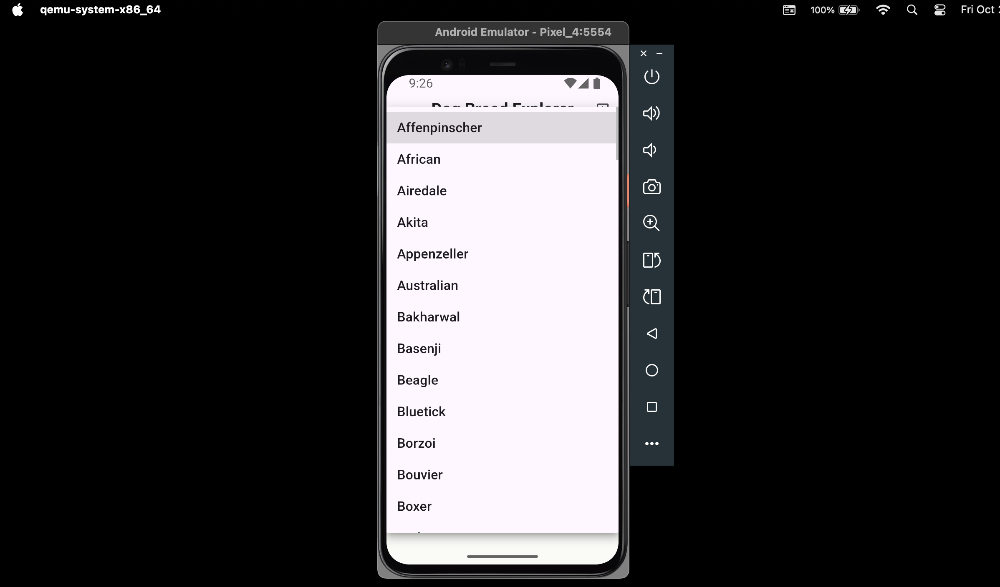
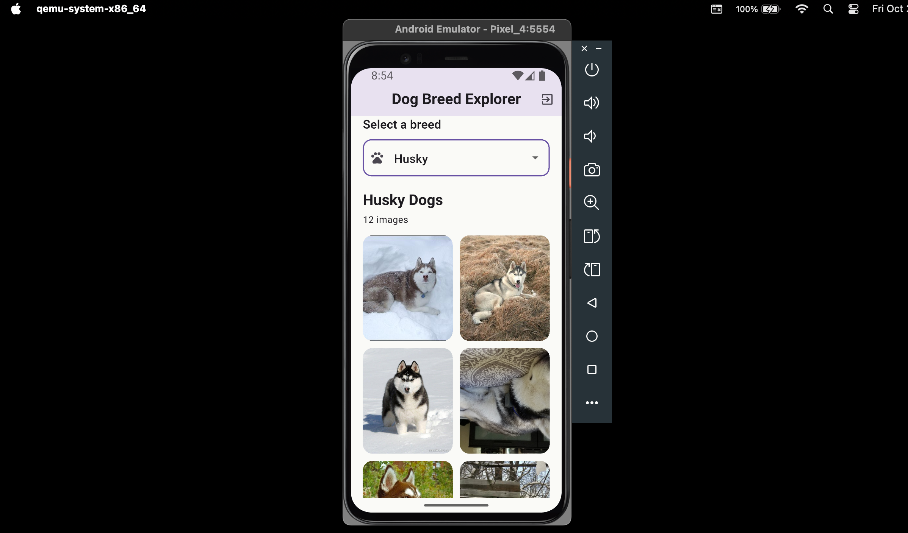
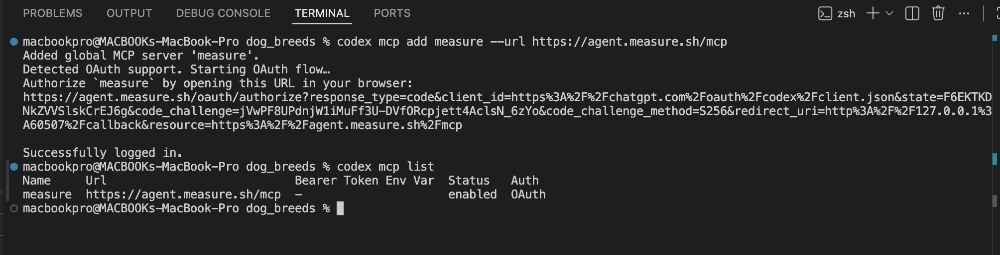
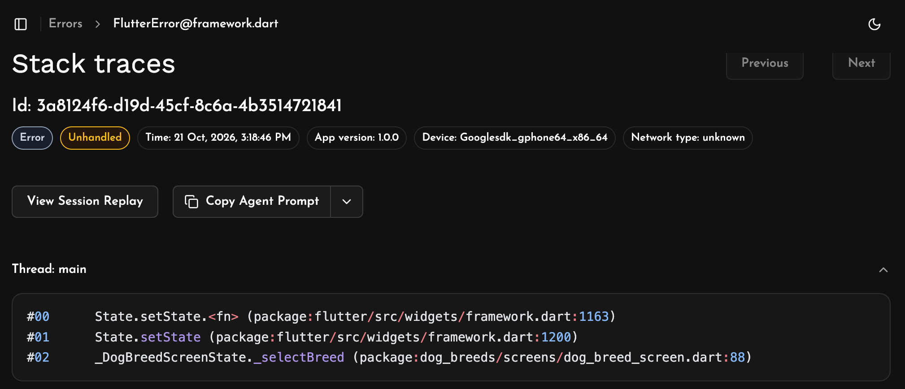
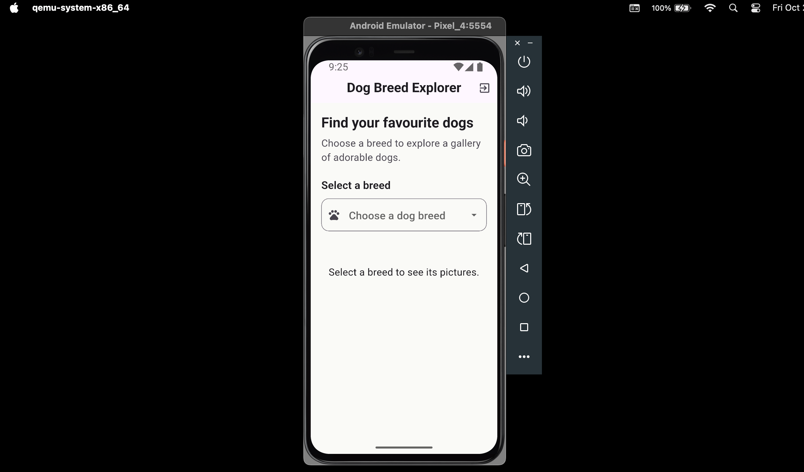
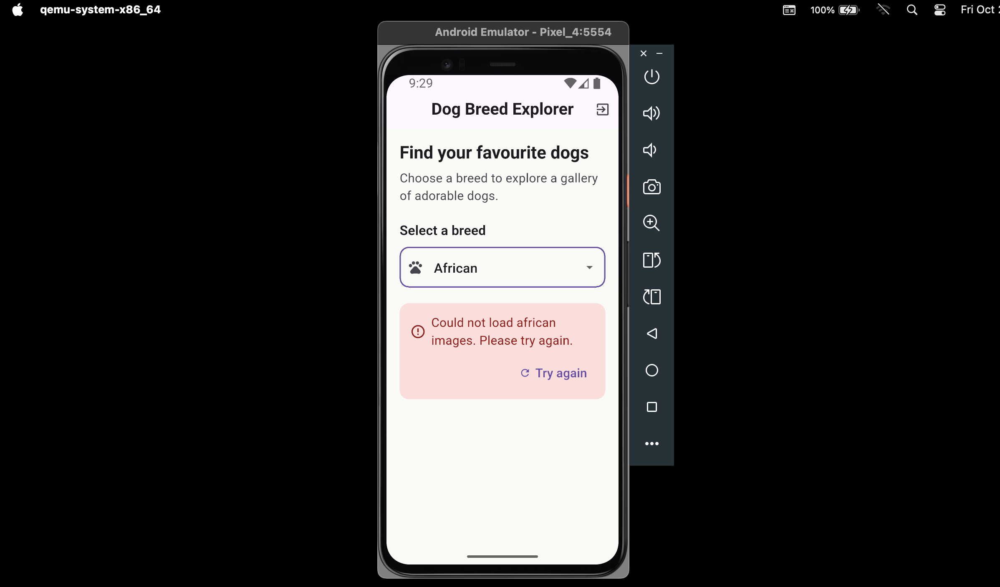

<div align="center">


<br />
<br />

# Dog Breeds Flutter App with Measure

### A Flutter app that sends production errors to a coding agent through Measure

A Flutter dog breed gallery instrumented with the Measure SDK. A deliberate exception is captured by Measure, then a coding agent reads it through the Measure MCP server to investigate and propose a fix.

<br />

[![Built by Studio1](https://img.shields.io/badge/Built_by_Studio1-f97316?style=for-the-badge&logo=data%3Aimage%2Fsvg%2Bxml%3Bbase64%2CPHN2ZyB4bWxucz0iaHR0cDovL3d3dy53My5vcmcvMjAwMC9zdmciIHZpZXdCb3g9IjAgMCAxNjAgMTYwIiBmaWxsPSJub25lIj48cGF0aCBmaWxsLXJ1bGU9ImV2ZW5vZGQiIGNsaXAtcnVsZT0iZXZlbm9kZCIgZD0iTTAgMzVDMCAxNi42ODA3IDE0LjA3NDQgMS42NDg0NCAzMiAwLjEyNjk1M1YxNDFINTEuMDUyM0M1Mi40MzA4IDEzNy4zNDQgNTQuNzQ0NiAxMzMuNjg5IDU3Ljk5MzggMTMwLjAzM0M2MS4xNDQ2IDEyNi41MDggNjQuNjg5MiAxMjMuNDQgNjguNjI3NyAxMjAuODI5QzcyLjU2NjIgMTE4LjM0OSA3Ni4zNTY5IDExNi43ODIgODAgMTE2LjEyOVY4Ni43NTQ0Qzc1LjQ3MDggODcuOTI5MiA3MS4zODQ2IDg5LjY5MTkgNjcuNzQxNSA5Mi4wNDE1QzY0IDk0LjUyMjUgNjAuNzUwOCA5Ny40NiA1Ny45OTM4IDEwMC44NTRDNTYuNTM0NSAxMDIuNzIgNTUuMjU0NSAxMDQuNjU5IDU0LjE1MzkgMTA2LjY3MVYwSDEyNUMxNDQuMzMgMCAxNjAgMTUuNjY5OSAxNjAgMzVWMTI1QzE2MCAxNDQuMzMgMTQ0LjMzIDE2MCAxMjUgMTYwSDEyNFYxOEgxMDQuOTQ4QzEwMy41NjkgMjEuNjgxNiAxMDEuMjU1IDI1LjM2MjggOTguMDA2MiAyOS4wNDQ0Qzk0Ljg1NTQgMzIuNTk0MiA5MS4zMTA4IDM1LjY4NDEgODcuMzcyMyAzOC4zMTRDODMuNDMzOCA0MC44MTIgNzkuNjQzMSA0Mi4zODk2IDc2IDQzLjA0NzRWNzIuNjMwNEM4MC41MjkyIDcxLjQ0NzMgODQuNjE1NCA2OS42NzI0IDg4LjI1ODUgNjcuMzA1N0M5MiA2NC44MDc2IDk1LjI0OTIgNjEuODQ5MSA5OC4wMDYyIDU4LjQzMDdDOTkuNDY1NSA1Ni41NTEzIDEwMC43NDUgNTQuNTk4NiAxMDEuODQ2IDUyLjU3MjNWMTYwSDM1QzE1LjY3IDE2MCAwIDE0NC4zMyAwIDEyNVYzNVoiIGZpbGw9IiNmZmZmZmYiLz48L3N2Zz4K)](https://studio1hq.com)
[](https://measure.sh)

[Measure docs](https://measure.sh/docs) &nbsp;·&nbsp; [Measure](https://measure.sh) &nbsp;·&nbsp; [More examples](https://github.com/Studio1HQ) &nbsp;·&nbsp; [studio1hq.com](https://studio1hq.com)

</div>

<br />

## Overview

A Flutter project that shows how to add [Measure](https://measure.sh) to an app and connect Measure to coding agents through its MCP server. Measure gives agents such as Claude Code and Codex production context, such as captured exceptions, so debugging is precise and you do not have to hunt for an exception with language-specific debuggers.

The app is simple. It fetches dog images from the Dog CEO API and shows them in a grid for the selected breed. An exception is introduced and captured by Measure. A coding agent then reads the captured result, investigates the bug and proposes a fix, which is applied only if you accept it.

<p align="center"> </p>

<details>
<summary>More screenshots</summary>

<p align="center"></p>
<p align="center"></p>
<p align="center"> </p>

</details>

## Features

- **Breed gallery**: pick a breed from a dropdown and see 12 random images in a grid.
- **Error and retry states**: friendly messages when breeds or images fail to load, with a retry button for the breed list.
- **Measure instrumentation**: the app is initialized with `measure_flutter` and wrapped in `MeasureWidget`, plus the native Android SDK and Gradle plugin.
- **Captured exception**: a deliberately introduced exception shows up in the Measure dashboard.
- **Agent debugging**: a coding agent reads the captured error through the Measure MCP server and suggests a fix.

## Tech stack

| Layer | Tool |
| --- | --- |
| Framework | [Flutter](https://flutter.dev), Dart 3 |
| Observability | [Measure](https://measure.sh) (`measure_flutter`, Android SDK and Gradle plugin) |
| Agent integration | [Measure MCP](https://measure.sh/product/mcp) with Codex or Claude Code |
| Data | [Dog CEO API](https://dog.ceo/dog-api/) |
| HTTP | `http` package |

## Getting started

### Prerequisites

- Flutter SDK (Dart `^3.13.4` per `pubspec.yaml`)
- An Android device or emulator
- A Measure app at [measure.sh](https://measure.sh) for the API key and URL
- A coding agent that supports MCP, such as Codex or Claude Code

### Installation

```bash
git clone https://github.com/Studio1HQ/dog_breeds.git
cd dog_breeds
flutter pub get
```

### Measure configuration

The Android app reads its Measure settings from `android/app/src/main/AndroidManifest.xml`. Set them to your own values.

| Meta-data name | Description |
| --- | --- |
| `sh.measure.android.API_KEY` | The API key of your Measure app. |
| `sh.measure.android.API_URL` | Measure ingest URL, `https://ingest.measure.sh`. |

Then connect your coding agent to the Measure MCP server by following the [Measure MCP guide](https://measure.sh/product/mcp).

### Run

```bash
flutter run
```

Pick a breed, trigger the error, then ask your agent to look up the captured exception in Measure and investigate.

## How it works

```text
lib/main.dart                        Measure.instance.init and MeasureWidget wrapper
lib/screens/dog_breed_screen.dart    Breed dropdown, image grid, error and retry UI
lib/services/dog_api_service.dart    fetchBreeds and fetchBreedImages against dog.ceo
android/.../MyApplication.kt         Measure.init for the Android layer
```

`fetchBreeds` calls `https://dog.ceo/api/breeds/list/all` with a 20-second timeout. `fetchBreedImages` calls `/breed/<breed>/images/random/12` with a 30-second timeout. Both throw on non-200 responses.

## Resources

- [Measure](https://measure.sh): open-source app monitoring.
- [Measure MCP](https://measure.sh/product/mcp): give coding agents production context.
- [Dog CEO API](https://dog.ceo/dog-api/): the image source.

<br />

---

<div align="center">

<a href="https://studio1hq.com">
  <picture>
    <source media="(prefers-color-scheme: dark)" srcset="https://raw.githubusercontent.com/Studio1HQ/website/main/brand/studio1-logo-on-dark.svg" />
    
  </picture>
</a>

Built by **[Studio1](https://studio1hq.com)**, the technical content and DevRel partner for devtool teams. Made with [Measure](https://measure.sh).<br />
Browse more open-source examples at [github.com/Studio1HQ](https://github.com/Studio1HQ).

[](https://studio1hq.com)
[](https://cal.com/studio1/collab)
[](https://x.com/Studio1HQ)
[](https://www.linkedin.com/company/studio1hq/)

<sub><a href="https://studio1hq.com">studio1hq.com</a> · Technical content, docs, video and DevRel for devtools</sub>

</div>
