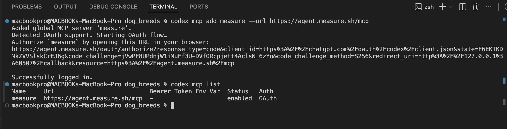
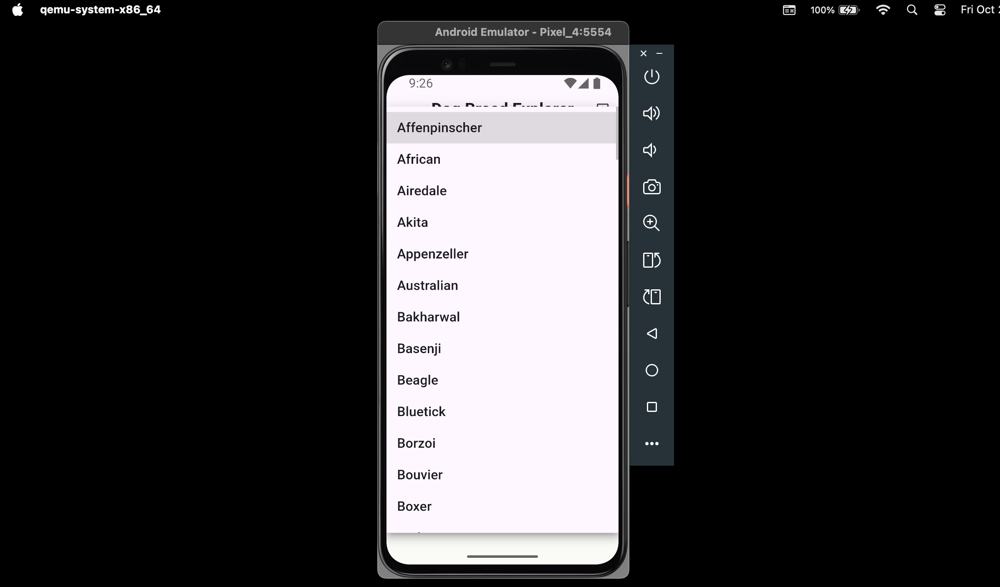
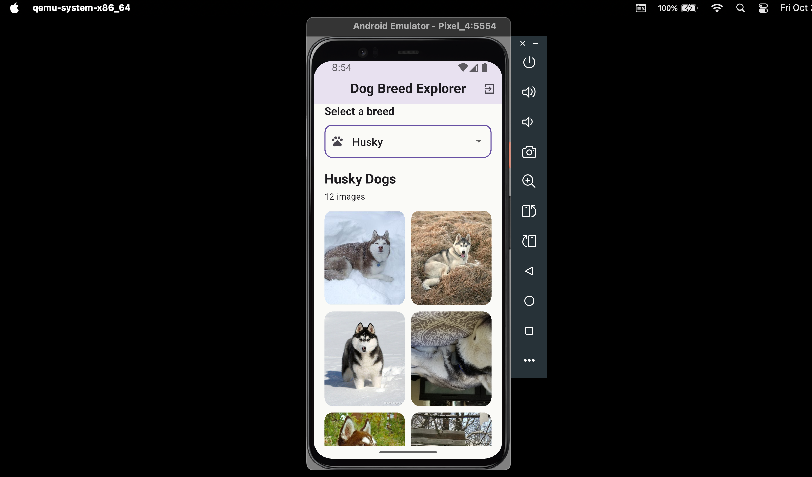
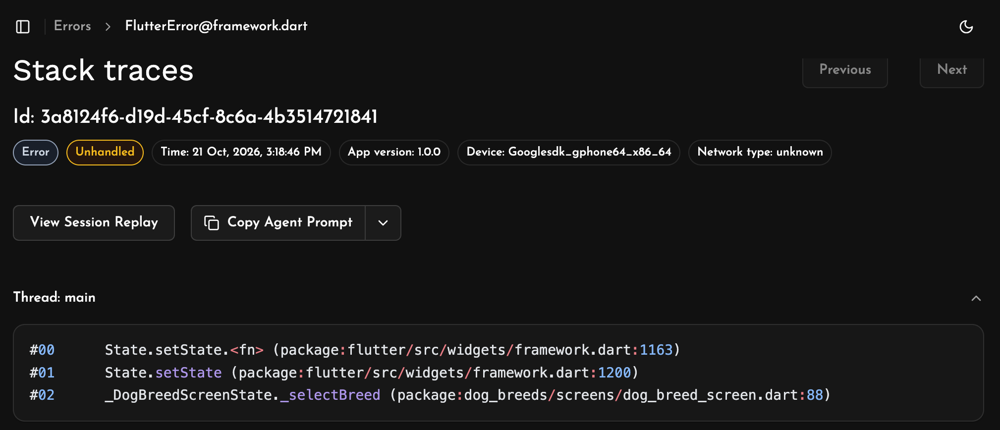

# dog_breeds

A Flutter project that helps implement Measure-sh capabilities and connecting it with coding agents via MCP server. 

## Getting Started
This Project helps us to understand the use of [Measure.sh](https://measure.sh) to provide production context to coding agents like Claude Code, Codex and many others, so that app debugging will be precise and time will not be wasted looking for a particular exception using tools like the language specific debuggers.

On the first innstance, Measure-sh SDK was setup in the project. Also, Codex was also setup as the coding agent, where Measure-sh MCP was accessed.

## About the App
The app is a simple app, where dog images are fetched from the Dog CEO API and displayed in a grid gallery according to the selected dog breed.

An exception is introduced, tested and captured by Measure. 

Then, a coding agent can take the captured result, investigate the bug and apply a fix, which is only applied when accepted by the programmer.

The Project helps to see the importace of using [Measure.sh](https://measure.sh) to debug our app, even when we are using a coding agent, we can easily provide a production conntext to it through [Measure.sh MCP](https://measure.sh/product/mcp).